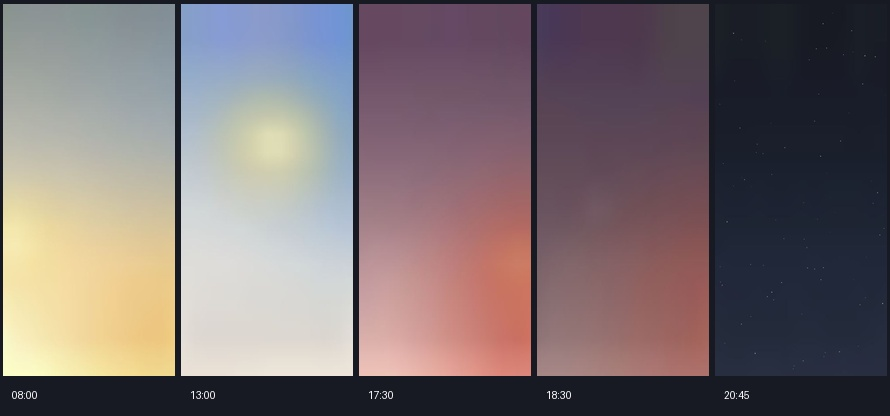
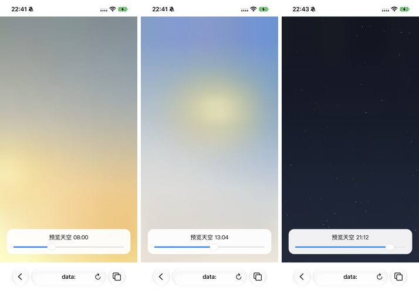
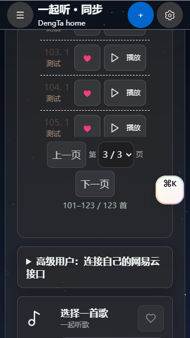
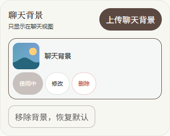

# 日出日落、私密图片和音乐页面审查

日期：2026-11-18。环境：Windows；开发分支 `feat/ios-import-75ad3da`；PR #2。

## 本轮修复

| 问题 | 现在的行为 |
| --- | --- |
| 原海岸场景与手机里的日夜参考不同 | 默认“日出日落”采用参考中33个钟点的天空颜色和光晕，按显示时间混合相邻画面；保留实时海岸和旧版天空可选 |
| 背景选项会重置明暗偏好 | 切背景保留 Auto / Day / Night、颜色和玻璃度；旧 `legacy-*` 选择迁移到可见的旧版选项 |
| 时间预览入口不容易发现 | 外观设置增加“预览天空”和“回到现在”；聊天更多功能里的时间控件仍可用，天气仅在实时海岸模式显示 |
| 命令面板里的背景切换未连接 | 三种背景都可通过命令面板切换 |
| 当前头像/壁纸不被识别 | 统一读取服务端 `user_avatar`、`companion_avatar`、`chat_background`，兼容旧字段；明确的默认值优先于旧字段 |
| 上传和启用状态不清楚 | 原生文件输入的点击区域至少44px；上传后提示点击“启用”，核验服务端保存回执，再显示当前选择；图库为空时仍可恢复默认 |
| iPhone 原始照片可能无法直接上传 | 静态 HEIC/HEIF 在支持解码的设备转换为JPEG；大JPEG头像居中裁切至1024方图，壁纸保留完整构图；解码失败给JPEG替代路径，关闭或切账号取消处理 |
| 调试壳中修改/删除图片弹窗无反应 | 使用网页内编辑和确认界面；账号或设置会话切换后旧操作不能更新新会话 |
| Android低负载模式隐藏自选壁纸 | 保留静态壁纸，不再把它与动态天空一起隐藏 |
| 网易云歌单只显示前60首 | 对服务端返回的完整曲目列表按50首分页；显示当前范围与总数，可前后翻页和跳页，保持实际曲目编号和ID |
| 音乐工作室被固定高度裁切 | 页面、iframe容器遵守宿主可用高度，去掉强制手机模式的重复底部占位；错误、超时、无效URL可恢复并保留浏览器打开/一起听入口 |
| 隐藏的海岸视频在窗口缩小时仍解码 | 监听手机断点变化，进入手机布局释放视频源；返回桌面可恢复 |
| 高像素密度手机的天气canvas尺寸不一致 | 绘制使用实际分配的像素比例，填满对应视口 |

## 参考还原与实际证据

已在 iPhone 的本地视频中确认22.13秒参考。视频包含手动滑动时间和操作菜单，不能把22秒理解成一天自动循环的速度。仅从其中的天空区域提取数字色值，用插值合成57,692字节的WebP色图；仓库中没有参考视频、原始截帧、其它App的UI或声音。

天空有清晨左侧暖光、午间较高光晕、午后偏右的暖光、橙粉暮色和深色星夜。采用静止星点；没有持续的动画帧循环、天空视频解码、网络资源或额外权限。桌面及手机宽高均铺满。

原片放大时顶部约20%出框，中央文字及下方控件也会遮挡天空，这些区域按周围颜色估算。视频快速拖动还会造成光晕位置暂时滞后。因此这里交付的是对可见背景的取样还原，不能宣称逐像素精确复刻被遮住的区域。

在五个实际浏览器截图中，用与建图色点不重合的50个参考点比较：sRGB各通道平均绝对误差约 **2.69/255**，最大单通道误差15/255。这个数字包含缩放、JPEG截图和空间插值误差，只描述这些可见取样点。

**iPhone 16e实测**：用同一生产背景组件构建独立预览，通过USB传入自包含页面，在Safari真实拖动时间，确认08:00 → 13:04 → 21:12的颜色、光晕位置和星点变化。没有使用账号或请求后端。下图含Safari界面，属于背景组件真机WebKit证据，不是新版IPA安装或整App验收。

LAN预览曾超时，Web Inspector未开启；本次未修改系统设置，临时HTTP服务已停止。

## 测试

- `npm test`：完整默认测试链通过；之后的小范围兼容修复和标签变更又通过对应定向测试。
- `npm run test:private-media`、`npm run test:sun-glass-chat`、`npm run test:music-listening`：通过。
- 天空/海岸新定向测试15项通过：取样时刻、相邻插值、午夜、旧偏好迁移、手机断点切换释放视频和3x密度canvas。
- `npm run build:web`：通过，包括CSP和公开登录配置校验。构建进程使用上一已验证调试IPA里的相同公开登录配置；没有提交配置或凭据文件。
- `scripts/check-private-media-mobile.mjs`：390×844实际浏览器中，用户头像、伴侣头像、壁纸分别选择文件→上传→启用→重开设置→恢复默认；3次上传与6次偏好写入均在内存假服务中完成，外网请求为0。另验证JPEG真实像素裁切、完整壁纸、坏HEIC和中途取消。图库缩略图是懒加载，测试滚动新增卡片后再核对图片。
- `scripts/check-music-mobile.mjs`：真实App命令面板→音乐工作室失败/返回/无效URL/重试→合成iframe→一起听→我的歌单。320×568、强制手机375×667、横屏667×375均可显示播放器及恢复入口；123首长标题测试歌单可访问第2、3页，末页显示101–123且下一页禁用。没有真实网易云播放或账号登录。
- Elephant–Goldfish独立审查：天空审查无实质问题；媒体审查发现早期iOS15不支持`Object.hasOwn`造成启动异常，已改为兼容调用并补缺失API回归；独立复审11项通过并关闭该问题。

浏览器脚本需要已有Playwright，可通过 `PLAYWRIGHT_MODULE` 指定模块地址、`PLAYWRIGHT_CHANNEL=msedge`选择Edge；证据输出目录分别用 `MEDIA_EVIDENCE_DIR` / `MUSIC_EVIDENCE_DIR`。在仓库根目录执行脚本；所有上传及写入都是合成内存数据。

原始运行日志、独立审查、图片和真机记录保存在仓库外 `D:/GZdeepseek/_audit/ios-visual-20261118/`。

## 调试IPA

- 版本：`0.1.4 (2026111803)`；独立标识`home.dengta.debug`。
- 文件：`DengTa-Debug-0.1.4-2026111803-web-f93d5658b998-unsigned.ipa`，19,780,554字节。
- IPA SHA-256：`ccf3264592657399c7869a6f2aaa357b0a5558fd97cc84f56cd624dfb876135e`。
- 完整Web文件清单SHA-256：`f93d5658b998e9a543c2cac5c372216985f9a32dff1d6aa2cb43c4e9fe71ab41`。
- 本机输出目录：`D:/GZdeepseek/_audit/ios-windows-debug-20261113/revision-0.1.4-2026111803/`，含包、文件摘要、打包脚本和校验清单。
- 已经USB传入iPhone的AllSign Documents，完整读回大小和SHA-256一致；传输回执在同目录`usb-transfer-receipt.json`。未操作签名或安装。
- 复用已验证的arm64 WKWebView调试宿主，仅更换本次Web产物和版本信息；验证ZIP CRC、完整读回、宿主可执行文件不变、公开配置一致和私有标记扫描。这是Windows离线重新打包，不是Xcode编译。
- 无设备签名或provisioning。原生Capacitor插件、Keychain和正式iOS工程构建仍需Mac环境验收。新版IPA尚未签名安装，不能把本轮Safari背景预览当作新版整App运行证据。

## 尚需实际账号/安装后确认

1. 在AllSign签名安装本版后，确认聊天、SSE、键盘及头像/壁纸完整链路。
2. 在iPhone系统相册选择真实静态HEIC，验证设备支持解码；不支持时使用JPEG。现有自动化只验证转换逻辑和失败恢复。
3. 在线音乐工作室由其它站点提供。跨站Cookie、iframe限制及第三方登录状态不能通过`iframe.onLoad`证明，也不能仅靠本仓库保证；保留浏览器入口，并需账号真机复验。分页覆盖服务端实际返回的曲目，不额外声称服务端已返回全部远端曲库。
4. 新默认天空按当前显示的上海民用钟点取样；实时海岸与界面明暗仍使用既有日出日落/定位模型。需要全球当地钟点对应时，可另行统一时区策略。

本轮未部署生产后端、数据库或生产前端，未合并PR。
