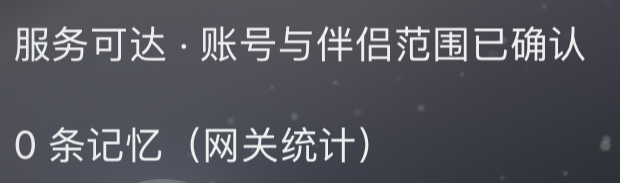

# DengTa · Kiwi 记忆核验（2026-11-18）

**真机上的网关计数确实是 0。** iPhone 16e，DengTa 调试版 0.1.2（2026111801，前端 `554a536`），北京时间 19:59。点击「检测连接与账号范围」后，已登录 App 显示服务可达、当前账号与伴侣范围已确认、0 条记忆；无障碍文本还读到「嵌入服务报告可用」。这证实的是该分区当时的网关统计。没有发送私人聊天来触发提取，没有验证真实模型或跨账号读取。后来尝试读取列表时页面已变化，点击前保护中止，未取得独立列表回执。

11 月 15 日只读探测：使用服务认证和本人分区取得 200、匹配的租户回执、计数 0；不带认证返回 401；当日网关 `/memory/items` 和 `/memory/profile` 返回 404。不能用三天前的 404 推断今天的接口状态，也不能仅凭健康接口证明聊天已经生成记忆。尚不能把这个账号的 0 归因于某一个生产故障。

## 代码里能复现的原因和修复

| 环节 | 旧行为 | 修复分支 |
|---|---|---|
| 读写来源 | 部分列表、日历摘要及其他读取路径走旧 SQL，统计与部分写入走 Kiwi；列表失败还能被当成零 | 长期记忆、自动画像、摘要和召回统一走 Kiwi。没有分区回执、接口缺失、失败、全库确认为空、搜索无匹配分别显示。认证、原始聊天和手写人设仍是独立功能 |
| 聊天→整理 | 收到聊天回复不等于提取完成；重复投递或进程中断容易丢失进度 | 用已保存的回复 ID 报送，Kiwi 持久记录任务；前端按任务 ID 区分受理、成功、失败和取消。用户明确整理时只重放当前分区选中的会话，遵守重置时间、可见性与来源；重试复用同一回合，不做全库回填 |
| 画像与摘要 | 素材来源和摘要读取路径不一致；分页途中可能公开部分结果，或让旧内容看起来刚更新 | 按分区分页整理有效素材。任务所有页成功并再次核对来源和租约后，才在同一事务发布画像、摘要、时间和游标；失败和取消保留上次确认的版本。页面和聊天上下文分别标明旧版。用户手写人设优先，不把伴侣角色设定当作用户事实 |
| 分区与隐私 | 一些旧授权无法映射到 Kiwi 条目；切换账号时，界面可能沿用旧请求 | 服务端从已验证的登录范围派生账号和伴侣；不信任客户端指定的分区，Kiwi 校验服务身份，客户端核对返回范围。切换账号或伴侣清除旧回执。旧外部通道授权不可直接读取主聊天记忆；QQ/微信来源不写入主聊天的 Kiwi 任务 |

记忆页可打开[产品内记忆与隐私说明](../public/memory-privacy.html)：哪些聊天内容可能发往 Kiwi 和配置的模型，自动整理与手填资料的区别，以及单条删除究竟确认什么。它不宣称已迁移旧记录、已删除原聊天/备份，也不替代发布时完整的隐私政策。

## 验证记录

- 前端：完整 `npm test`、`npm run build:web` 通过。最终画像与任务呈现 13/13；合成 A→B→A 快速切换、任务并发、失败、重开页面仍显示旧摘要均有覆盖。[离线布局数据](evidence/kiwi-20261118/offline-layout.json)覆盖 280–768 像素宽、44 像素以上的按钮。布局数据来自 Windows Edge，不是新版 iPhone 截图。
- 后端：完整 `npm test` 通过；`npm run test:kiwi-client` 24/24，覆盖分区、总数、旧摘要、错误码、重试、历史重放和外部通道。导入防护的数据库迁移只在隔离数据库验证，不在生产执行。
- Kiwi：一次性本机 PostgreSQL 16.4，147 项既有保护用例通过；另测 202 条合成来源跨两页、任务重启、数据重置、不同账号/伴侣隔离、归档过滤。额外测试复现了旧实现第二页失败仍发布半成品，修复后验证了失败、取消、同任务重试及处理过程中来源改变。测试使用仿真模型，不证明线上模型、额度或语义召回正常。
- 大象与金鱼：独立审查发现跨页错误发布；修正后，另一名无前文审查者复核事务和回归用例，未发现阻止此修复交付的问题。Muse 只评审虚构的账号切换与错误状态，没有接收账号、密码、私人聊天或截图。

为后续真机验证另行生成 **0.1.3（2026111802）未签名调试 IPA**。已从归档读回全部 156 个网页文件核对，IPA SHA-256 为 `425276a005e580380db96141619a3af581ab5e7fbad414699db6d2125be4f9f9`。它使用既有 arm64 WKWebView 宿主；未安装到上述手机，不含完整 Capacitor 插件/原生 Keychain，不能当作完整 iOS 版验收。

## 审查之后怎样验证

1. 先更新 Kiwi，在隔离测试分区核对鉴权、状态、列表、画像、任务和后台 worker；缺少配置或网关版本过旧时必须返回明示错误。不要用召回数量代替统计。
2. 然后更新后端，再更新客户端。后端的旧通用导入防护 SQL 需由维护者独立审查后执行，不迁移或清除任何生产数据。三个代码版本应一起记入发布记录。
3. 用同意测试的单个会话发送一条无害且可长期记住的偏好，记录 SSE 完成、任务 ID/终态、列表和摘要的实际回执；再次打开会话核对召回。没有提取到新事实可以是正常结果；任务失败、没有可信回执和有效的零不可混淆。
4. 用两个合成账号、每个账号两个伴侣重走切换与删除，确认不同分区互不可见。确需验证旧历史时，只在用户选定的会话点「立即整理当前对话」，先取得对应回执。一次单条删除不能证明整份摘要、备份或账号资料已清除。

本轮未部署网关或后端，未操作生产 Supabase，未用用户消息做导入，也未将新代码的测试结果当作已安装版本的实测。
